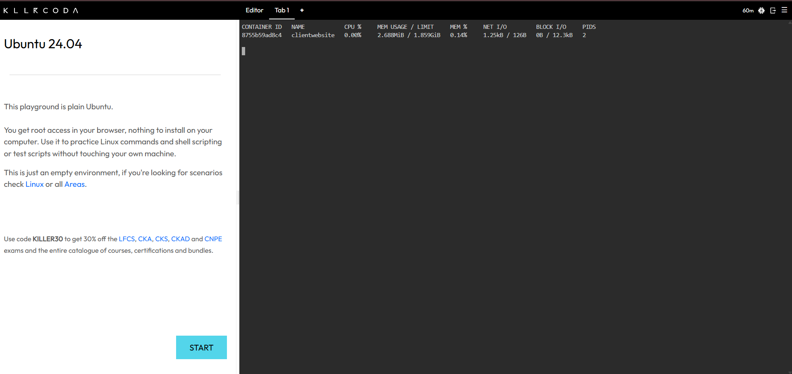

# Container Observability

## 1. Application Logs

**404 Error Log:**

`[I-paste dito ang eksaktong 404 error line mula sa docker logs]`

## 2. Importance of Application Logs

Application logs are important because they help us identify errors and understand what happened when a website or application does not work properly. They also help us troubleshoot problems faster by showing the requests received by the server and the HTTP status codes returned.

## 3. Screenshot Evidence

### Docker Logs Screenshot

## 4. Real-Time Container Metrics

The `docker stats` command was used to monitor the container's resource consumption in real time.

- **Container Name:** clientwebsite
- **Memory Usage:** [Ilagay ang aktuwal na Memory Usage]
- **CPU Usage:** [Ilagay ang aktuwal na CPU percentage]

These metrics help us check whether the container is using too much memory or CPU. Monitoring resource usage helps us identify possible performance problems and keep the application running smoothly.

### Screenshot Evidence

