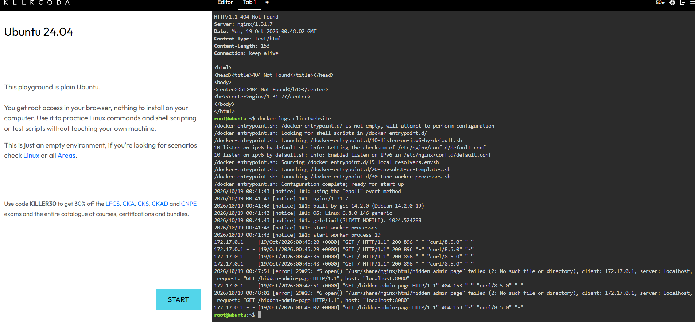

# Container Observability

## 1. Application Logs

**404 Error Log:**

`"GET /hidden-admin-page HTTP/1.1" 404`

## 2. Importance of Application Logs

Application logs are important because they help us identify errors and understand what happened when a website or application does not work properly. They also help us troubleshoot problems faster by showing the requests received by the server and the HTTP status codes returned.

!## 3. Screenshot Evidence

### Docker Logs Screenshot

