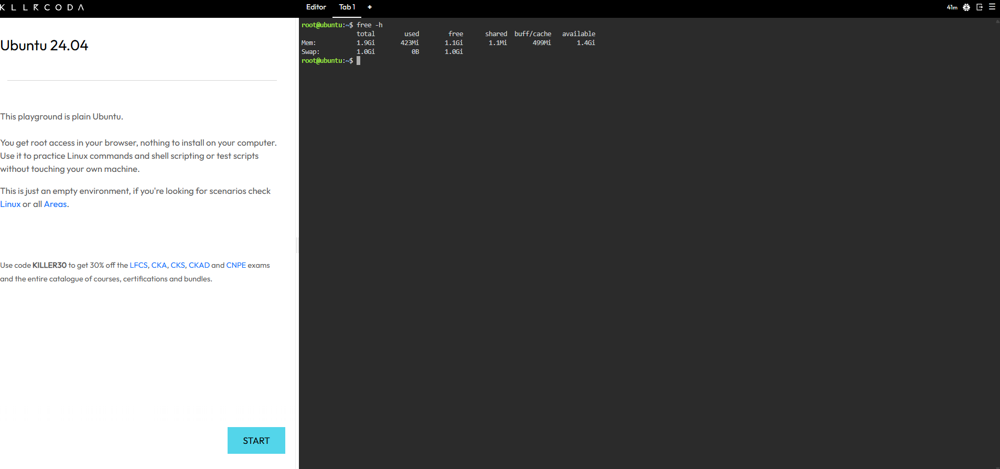
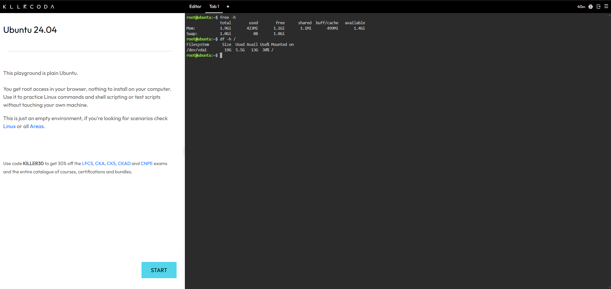

# System Baseline Report

## 1. Memory (RAM) Check

- **Total RAM:** 1.9 GiB

## 2. Disk Storage Check

- **Total Storage Capacity of Root (/):** 19G

## 3. Importance of Disk Space Monitoring

Checking disk space is important before a massive traffic surge because the server needs enough storage for logs, temporary files, and application data to prevent errors or service interruptions.

Screenshot Evidence — Memory Check

